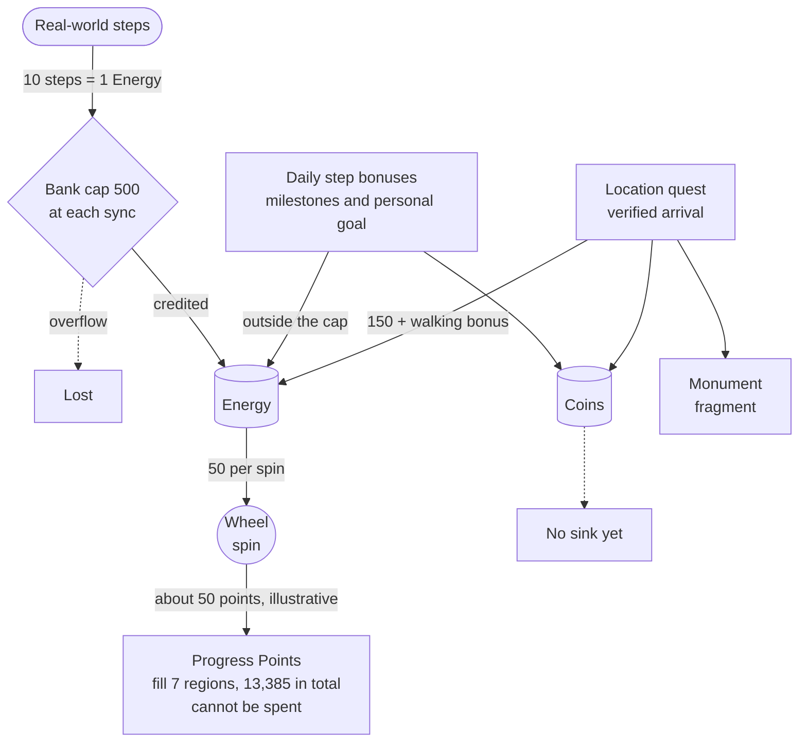
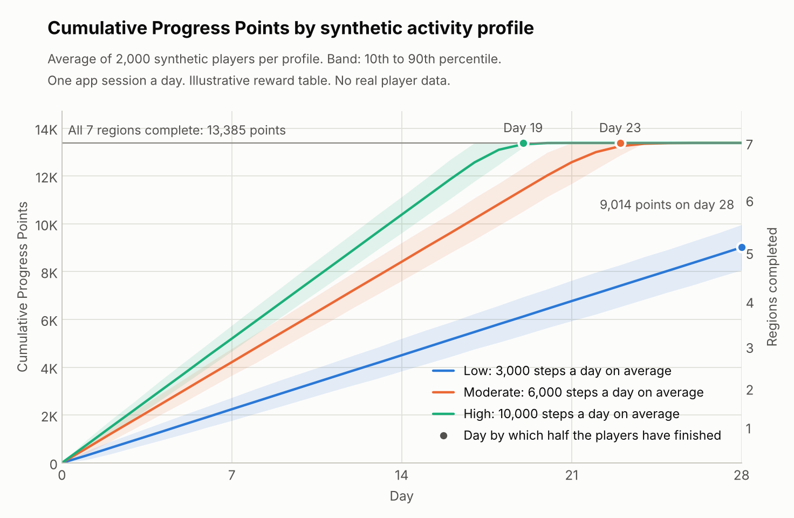
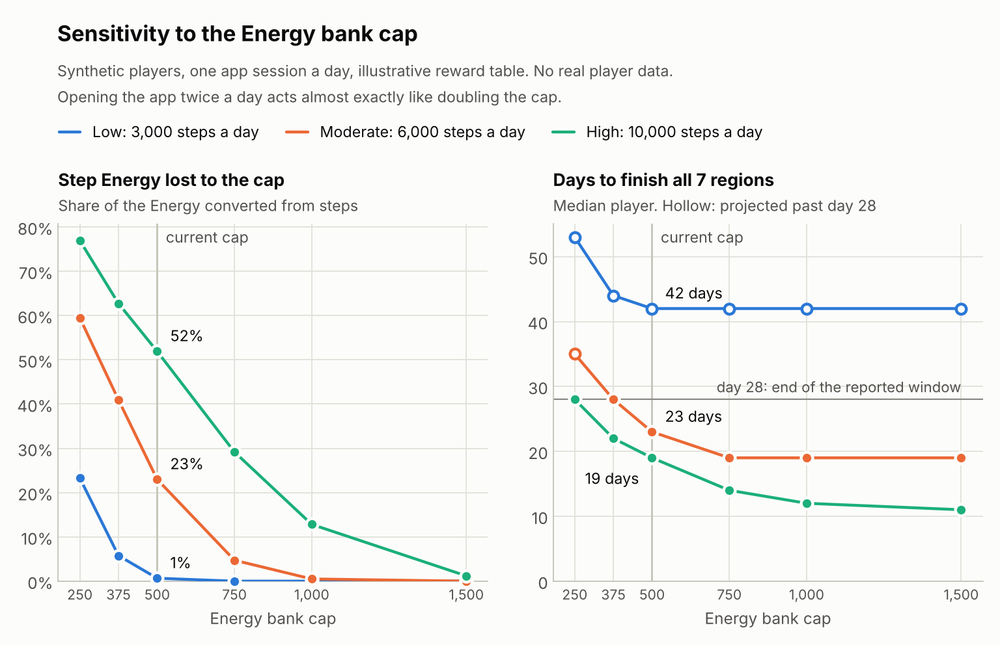

# Wellness Odyssey — Game Economy Design & Simulation

*Or Hotoveli · October 2026*

> **Pre-launch case study.** Wellness Odyssey has not launched. There are no real players, no revenue and no commercial partners. Every player in this analysis is synthetic, the wheel's reward table is an illustrative stand-in for the confidential production one, and every commercial figure is hypothetical.

## 1. Project Overview

Wellness Odyssey is a mobile walking game I am building. Real steps become Energy, Energy buys spins of a reward wheel, and the Progress Points the wheel pays move the player through seven travel regions. Location quests reward arriving at real places.

The economy's main source is physical activity, which a player cannot farm inside the game. Pacing therefore depends on how far people walk and how often they open the app, and the designer controls only conversion rates, caps and sinks.

This repository documents that economy as the game implements it, simulates 28 days of play for three synthetic activity profiles, tests the Energy cap as a design lever, and proposes a location-based B2B monetization model with a post-launch experiment.

**What the model shows**

1. **Content runs out in about three weeks.** Synthetic players averaging 6,000 steps a day finish all seven regions around day 23, and 10,000-step players around day 19. After that, Energy has nothing to buy.
2. **The Energy cap, not walking, sets the pace for active players.** With one app session a day it discards 52% of the Energy a 10,000-step player converts from steps. Walking 67% more than the 6,000-step player earns 23% more Energy.
3. **Low-activity players get the thinnest rewards, and the largest lever is one they set themselves.** Lowering the personal step goal to its minimum raises a 3,000-step player's Energy by 30% with no extra steps.

| Label used below | Meaning |
|---|---|
| **Implemented** | A rule of the game as it is built today. Sections 2 and 3 describe these |
| **Illustrative** | A synthetic stand-in for a confidential value. There is one: the wheel's reward table |
| **Proposed** | New in this case study: the simulation, the design implications, the monetization concept and the experiment |

## 2. Game Economy at a Glance

**The core conversion:** 500 steps → 50 Energy → 1 paid spin → 50 Progress Points on average under the illustrative reward table.

| Resource | What it is | Sources | Sinks |
|---|---|---|---|
| **Energy** | Spendable fuel | Steps at 10 steps per Energy, daily step bonuses, quest arrivals | Wheel spins at 50 Energy each. Nothing else |
| **Progress Points** | Progress, not a currency. They cannot be spent | Wheel spins | Fill region costs of 1,500 × 1.08^(n−1): seven regions, 13,385 points in total |
| **Coins** | Second currency | 10 at sign-up, daily step milestones, quest arrivals | None yet |
| **Monument fragments** | Collectible | Quest arrivals only | Complete five-piece sets, one per region |

**The Energy bank cap is 500, and it is narrower than it sounds.**

- It limits only Energy converted from steps, at the moment of a sync: the game credits up to 500 minus the current balance and discards the rest.
- Steps sync when the player opens the app, so the cap bites per session, not per day.
- Bonuses and quest rewards are added on top of the cap, and unspent Energy never expires.

**Daily bonuses** (each paid once a day, all outside the cap):

| Reached in a day | 3,000 steps | 7,000 | 10,000 | 15,000 | Personal goal (default 5,000) |
|---|---|---|---|---|---|
| Energy | +50 | +75 | +100 | +150 | +100 |
| Coins | +25 | +50 | +100 | +200 | |

**The wheel.** Each spin pays Progress Points from a weighted reward table. One wedge is a free respin: it pays nothing, costs no Energy, and the wheel is spun again. The production table is confidential and is not reproduced here. The simulation uses this illustrative one instead:

| Progress Points | 20 | 30 | 50 | 80 | 150 | Free respin |
|---|---|---|---|---|---|---|
| Illustrative probability per draw | 22% | 26% | 28% | 16% | 7% | 1% |

The table has two averages, and the free respin is the difference between them. Over all draws, counting the respin as zero, it pays 49.5 points. A respin is never paid for, so every 50 Energy spent ends on one of the five paying wedges, and the average per paid spin is 49.5 ÷ (1 − 0.01) = 50.0 points, with a standard deviation of 34. I chose the weights so that this equals the 50-Energy cost of a spin: one point per Energy. Every per-spin figure in this README is per paid spin.

This table is not the game's actual configuration. Point totals and finish dates below depend on it: they move in inverse proportion to the average pay-out, so a table paying 10% more would bring every finish date forward by about 9%. Energy income, cap losses and bonus shares are set by the game's rules and do not depend on the reward table.

**Location quests.** The player starts a quest, travels by any mode, and claims it on verified arrival at the destination. The reward is 150 Energy, 100 Coins and one fragment. A walking bonus adds 20% Energy on real steps taken on the way, up to a limit tied to the distance. One quest can be active at a time and each destination pays once. Quests are not sponsored today.

**Economic design questions**

| Question | What the design does, and what the model adds |
|---|---|
| How much should walking earn? | 1,000 steps buy two spins, about 100 points under the illustrative table. Pacing is decided by Energy income, not by wheel luck |
| How fast should each activity level progress? | The three profiles finish the seven regions on days 42\*, 23 and 19. Walking 3.3 times as much makes progress 2.2 times as fast |
| When does the Energy cap become restrictive? | Above roughly 5,000 steps between two app sessions. At one session a day it removes 23% of step Energy at 6,000 steps and 52% at 10,000 |
| Can highly active players advance too quickly? | Relative to the content, yes. The 10,000-step profile is done on day 19, or day 12 with two sessions a day |
| Could low-activity players feel under-rewarded? | They wait five days for the first region and get 8% of their Energy from bonuses, because the default goal and most milestones sit above their usual day |
| Does the reward structure sustain activity without frustration? | Milestones keep paying above the cap, so a long walk is never worth nothing. Energy that is earned and then discarded is still the likely frustration point |

\* A projection past the 28-day window. See section 4.

## 3. Economy Flow Diagram



## 4. Simulation Methodology

**Synthetic profiles.** These are modelling scenarios, not observed player segments.

| Profile | Average steps a day | Why this level |
|---|---|---|
| Low | 3,000 | Sits on the first milestone and reaches it on about half its days |
| Moderate | 6,000 | Just above the 5,000-step day the economy is tuned to |
| High | 10,000 | Twice that target, and a common personal goal |

Each synthetic player's steps vary from day to day around the profile average (gamma distribution, coefficient of variation 0.30). This matters because the game pays bonuses at fixed thresholds: a player who walked exactly 3,000 or 10,000 steps every day would collect a bonus daily, and constant steps would overstate income. Each profile has 2,000 synthetic players and a fixed random seed.

**Baseline behaviour (assumed).** One app session a day, all available Energy spent, no missed days, the default 5,000-step goal, no quests.

**Daily sequence**, in the order the game applies it:

1. Start with yesterday's unspent Energy.
2. At the app session, convert the day's steps to Energy at 10 to 1. Leftover steps carry over.
3. Apply the cap to that step Energy: credit up to 500 minus the current balance. The rest is lost.
4. Add milestone and goal bonuses on top.
5. Spin while the balance covers a whole 50-Energy spin, drawing each result from the reward table. Spins are whole numbers. A draw that lands on the free respin is not charged and not counted as a spin: the player draws again.
6. Carry the remainder to the next day.

**The seven-region limit.** Once the seventh region is complete the game accepts no further spins. The model stops spinning for that player from that moment, while Energy keeps arriving with nothing to spend it on.

**Reported window and projection.** The reported window is 28 days, and every result in this README is measured inside it with one exception. To say when a slower profile would finish, each run continues to day 120 under the same rules and assumptions. A finish day later than 28 is therefore a projection from that longer run, not a 28-day result, and is marked with an asterisk wherever it appears.

**Expected and realized.** Expected points are paid spins × the average pay-out per paid spin, which is 50.0 under the illustrative table. Realized points are drawn spin by spin. The chart shows the average across players and the band from the 10th to the 90th percentile.

**Scenarios** on the same synthetic players: two app sessions a day, the personal goal set to its 1,000-step minimum, and two quest arrivals a week.

**Checks** run before every simulation:

- Hand-calculated days. For example, 10,000 steps in one session must credit 500 Energy, lose 500, add 325 in bonuses and fund 16 spins.
- The seven-region limit. With a test wheel that always pays 100 points, the 13,385 points must take exactly 134 spins and not one more, however much Energy arrives afterwards.
- The free respin. With a test wheel that lands on the respin half the time and otherwise pays 100 points, 650 Energy must still buy exactly 13 paid spins, each paying 100. On the illustrative wheel the simulated average must match 50.0 points per paid spin within sampling error, a tolerance tight enough to rule out the 49.5 per draw, and free respins must turn up at the stated 1% of draws.
- Energy conservation on every simulated player-day.

## 5. Results and Visualizations

Baseline, one app session a day.

| | Low · 3,000 steps | Moderate · 6,000 | High · 10,000 |
|---|---|---|---|
| **Daily averages, while regions remain** | | | |
| Energy converted from steps | 300 | 600 | 995 |
| Lost to the cap | 2 (1%) | 138 (23%) | 517 (52%) |
| Credited after the cap | 298 | 462 | 478 |
| Bonus Energy | 26 | 140 | 265 |
| **Energy income** | **323** | **602** | **743** |
| Paid spins | 6.5 | 12.0 | 14.8 |
| Energy spent on spins | 323 | 601 | 742 |
| Unspent Energy carried to the next day | 24 | 14 | 22 |
| Expected Progress Points | 323 | 601 | 742 |
| **At the end of the 28-day window** | | | |
| Cumulative points (10th to 90th percentile) | 9,014 (8,060 to 9,961) | 13,385 | 13,385 |
| Regions completed | 4.6 of 7 | 7 | 7 |
| Players who have finished all seven | 0% | 100% | 100% |
| **Timing** | | | |
| First region complete, median day | 5 | 3 | 3 |
| All seven complete, median day (10th to 90th percentile) | 42\* (38 to 46) | 23 (21 to 24) | 19 (17 to 20) |

\* Projection past day 28, from the same simulation continued to day 120. Spins are paid spins: free respins are not counted, here or in the `spins` columns of the output tables. Expected points equal Energy spent because a paid spin costs 50 Energy and returns 50 points on average under the illustrative table.



**Sensitivity: the Energy bank cap.** The cap is the lever I tested because an earlier design set it at 250 before it was raised to 500, and because its effect depends on player behaviour.



| Scenario | Energy income per day (Low / Moderate / High) | Day all seven regions are complete, median |
|---|---|---|
| Baseline | 323 / 602 / 743 | 42\* / 23 / 19 |
| Two app sessions a day | 325 / 733 / 1,127 | 42\* / 19 / 12 |
| Personal goal at the 1,000-step minimum | 421 / 633 / 746 | 32\* / 22 / 19 |
| Two quest arrivals a week | 374 / 650 / 797 | 36\* / 21 / 17 |
| Bank cap 250, the earlier value | 256 / 383 / 495 | 53\* / 35\* / 28 |
| Bank cap 1,000 | 325 / 733 / 1,129 | 42\* / 19 / 12 |

\* Projection past day 28, as above.

Full tables are in [`outputs/`](outputs): the day-by-day ledger, the scenario summary and the cap sensitivity.

## 6. Three Key Economic Insights

### 1. The seven regions are a three-week game for anyone at or above 6,000 steps

- **What the model shows.** Half of the Moderate players finish by day 23 and half of the High players by day 19, and every player in both profiles has finished by day 28. Low players have completed 4.6 regions by day 28; the longer run projects their finish at about day 42. After the seventh region Energy has no sink: on day 28 the average High player holds 3,051 unspendable Energy and 3,507 Coins, which never had a sink.
- **Why it matters.** The most engaged players reach the end of the content first, in the weeks when a habit is still forming. An economy with sources and no sink stops meaning anything to the player holding the balance.
- **What limits it.** The model assumes players spend all their Energy every day and never miss a day, so these are the earliest plausible finish dates. Real players will be slower. The dates also depend on the illustrative reward table.

### 2. For active players the bank cap sets the pace, and it rewards opening the app more than walking

- **What the model shows.** With one session a day the cap discards 1%, 23% and 52% of step Energy for the three profiles. Energy per 1,000 steps falls from 108 for Low to 75 for High. A second daily session cuts the High player's loss to 13% and raises income by 52%, which is almost exactly the effect of doubling the cap. At the earlier cap of 250 the Moderate player would lose 59% and finish on a projected day 35 instead of day 23.
- **Why it matters.** The cap does two jobs at once. It brings players back to the app, and it stretches the content for heavy walkers. But it makes the marginal reward for steps above about 5,000 close to zero between milestones, which sits badly with a product whose promise is that walking more is worth it.
- **What limits it.** Sessions per day is an assumption and drives the whole result. If real players open the app twice a day, most of this loss disappears.

### 3. Low-activity players get the thinnest rewards, and the largest lever is one they set themselves

- **What the model shows.** Bonuses supply 8% of the Low player's Energy against 36% for High. The Low player reaches the default 5,000-step goal on 2% of days and the first milestone on 46%, and waits five days for the first region. Setting the personal goal to the 1,000-step minimum raises Low income by 30% with no extra steps and moves the projected finish from day 42 to day 32. The same change is worth 5% to Moderate and under 1% to High.
- **Why it matters.** The goal bonus is a flat 100 Energy whatever goal the player picks, so the highest-paying choice is the lowest goal. That is an accessibility feature for players who need an attainable target, and an invitation to sandbag for everyone else.
- **What limits it.** Whether players ever change the goal setting is unknown. How much reward a low-activity player needs in order to stay is a retention question this model cannot answer.

**A note on luck.** Under the illustrative table a single paid spin has a standard deviation of 34 points on a 50-point average, but over a month that washes out. Day-to-day steps and wheel luck together put 80% of Low players within about 11% of the average 28-day total. Finish days are whole days, so a median that sits on a boundary can move by one day with the random seed. Across twelve seeds the baseline median was a projected day 42 for Low, day 23 for Moderate and day 18 or 19 for High, and three of the fifteen scenario medians in section 5 also moved by a day.

## 7. Product Design Implications

What I would take into a balancing discussion, with what each option costs. All of it rests on the simulation and inherits its assumptions.

| Area | What the model shows | Options | Trade-off |
|---|---|---|---|
| **Content exhaustion and pacing** | Players at 6,000 steps or more finish in 19 to 23 days. After that Energy and Coins accumulate with nothing to buy | Add regions. Raise the 8% cost step between regions. Give finished players a sink | More content costs production time. A steeper curve also slows low-activity players, whose finish is already projected at day 42. A sink is a new system to build |
| **Energy cap friction** | At one session a day the cap discards 23% of step Energy at 6,000 steps and 52% at 10,000 | Raise the cap. Credit overflow at a reduced rate instead of zero. Warn the player before the bank fills | The cap is also the pacing brake: at 1,000 the High profile finishes on day 12 instead of day 19. Removing friction without adding content shortens the game |
| **Uneven rewards across activity levels** | Bonuses are 8% of Energy for Low and 36% for High. Energy per 1,000 steps falls from 108 to 75 as the cap bites. A flat goal bonus pays best at the lowest goal | Scale the goal bonus with the goal relative to the player's own recent average. Add an earlier milestone. Shorten the first region | Richer low-end rewards speed everyone up unless they are targeted. Personal goals need a baseline period and are harder to explain |

**Sequencing.** I would fix the target length of the game first, because every other lever moves it. Then size the cap for the session rhythm the product wants, and tune bonuses last. Each step stays a hypothesis until the post-launch measurements in section 10 exist.

## 8. Location-Based Monetization Concept

Quests already send players to real places and verify arrival. The concept is to let local businesses sponsor selected quests: players get a destination and a reward, businesses get countable visits from people who chose to come, and the game gets B2B revenue without selling currency or showing ads. **Quests are not sponsored today. There are no sponsorship agreements, and nothing here is revenue.**

Three pricing models, in a hypothetical one-city pilot of 20 sponsored quests and 500 verified visits a month:

| Model | Revenue | Contribution | Merchant's cost per visit | Who carries volume risk |
|---|---|---|---|---|
| Fixed fee, $150 per quest | $3,000 | $2,075 | $6.00 | Merchant |
| Per verified visit, $2.00 | $1,000 | $75 | $2.00 | Game |
| Hybrid, $50 + $1.25 per visit | $1,625 | $700 | $3.25 | Shared |

**Recommendation:** test cost per verified visit first, with a monthly budget cap for each merchant, then move to the hybrid once volumes are known. Per-visit pricing puts a price on the one thing a merchant is buying, so acceptance of that price is direct evidence of what a visit is worth, and paying only for results is an offer an unproven channel can make. At these placeholder costs it needs about 23 visits per quest per month to break even, which is why it is a test model and not the end state.

**Quest rewards are not neutral for pacing.** In the simulation two quest arrivals a week add about 50 Energy a day to every profile, one extra paid spin. Energy income rises by 16% for Low, 8% for Moderate and 7% for High, and the median finish moves from a projected day 42 to a projected day 36 for Low, from day 23 to 21 for Moderate and from day 19 to 17 for High. Because the reward is flat it matters most, in proportion, to low-activity players, and it also shortens a game that active players already finish in three weeks. Both effects grow with how often players complete quests, which is unknown, so how much Energy a sponsored quest pays is a balancing decision.

Full comparison, unit economics and seven strategic risks: [`docs/monetization_and_experiment.md`](docs/monetization_and_experiment.md).

## 9. Proposed Post-Launch Experiment

No experiment has been run. This is the design for when the game has real players.

- **Question.** Does offering optional sponsored quests improve meaningful engagement without harming the health-oriented core?
- **Design.** Player-level 50/50 randomization among eligible players in a pilot city. Control sees regular quests only. Treatment sees the same number of quest slots with at most one labelled sponsored quest carrying the same in-game reward.
- **Primary metric.** Week-4 retention: at least one credited step sync on days 22 to 28 after assignment.
- **Test.** Non-inferiority first. The 95% confidence interval for the retention difference, treatment minus control, must rule out a loss larger than a margin fixed before launch. I propose 2 percentage points as the starting value. It is a proposal, not a finding, and it has to be justified and agreed before the first player is assigned.
- **Guardrails.** Daily steps per active player, spins per active day, sponsored-quest hide rate, location-permission revocations and fraud flags, each with a tolerance set in advance.
- **Sample size.** Not computed, because there is no baseline. The document gives the formula and lists the five kinds of baseline data a run-in period has to supply first.
- **Decision rule.** Expand only if non-inferiority is shown, no guardrail is breached, and verified visits per quest reach the pricing model's break-even. A retention difference that is merely not significant counts as inconclusive, not as proof of no harm.

Full design, including eligibility, confounders and data requirements: [`docs/monetization_and_experiment.md`](docs/monetization_and_experiment.md#6-proposed-post-launch-ab-experiment).

## 10. Assumptions and Limitations

Every number the model uses is in [`assumptions.csv`](assumptions.csv) with one of four labels: **verified** (22 game rules), **illustrative** (the 6 rows of the stand-in reward table), **assumption** (12 modelling choices) or **hypothetical** (12 commercial inputs). The production reward table, anti-fraud rules, quest locations, internal configuration and source code are intentionally not in this repository.

### Limitations: Pre-Launch Simulation

- There are no real player behaviour datasets. The game has not launched.
- The activity profiles are synthetic. Their step averages and day-to-day variation are assumptions.
- Progression outcomes are generated by the model, not observed.
- The reward table is illustrative, so point totals and finish dates are not the game's actual values.
- Finish days later than day 28 are projections from a longer run of the same model.
- Retention cannot be established from the simulation. It contains no decision to stay or leave.
- Players' willingness to take part in sponsored quests is unknown.
- Merchants' willingness to pay has not been validated. There are no sponsorship agreements.
- The monetization model is a business hypothesis, not demonstrated revenue.
- All findings depend on the documented assumptions, above all one app session a day and no missed days.

### What We Would Validate After Launch

1. **The real distribution of daily steps**, its level and its day-to-day variation, to replace the synthetic profiles.
2. **App sessions per day and how often the bank is full at sync.** This decides how much the cap really discards and is the model's most influential assumption.
3. **Retention against progression pace**: D1, D7 and D28 by time to first region, and what players do after the last one.
4. **The quest funnel by distance**: shown, started, verified arrival. These rates drive the unit economics.
5. **What a verified visit is worth to a merchant**: the price accepted, redemptions, renewals, and the share of claimed visits that turn out to be fraudulent.

## 11. How to Reproduce the Analysis

```bash
pip install -r requirements.txt   # numpy and matplotlib; Python 3.9 or newer
python economy_model.py
```

The script runs its checks, simulates every scenario and rewrites everything in `outputs/` in a few seconds. A fixed seed makes every number in this README reproducible.

| File | What it holds |
|---|---|
| [`economy_model.py`](economy_model.py) | The rules, the simulation, the checks and the charts |
| [`assumptions.csv`](assumptions.csv) | Every input, labelled verified, illustrative, assumption or hypothetical |
| [`outputs/daily_ledger.csv`](outputs/daily_ledger.csv) | Day-by-day Energy and points for each profile, 28 days |
| [`outputs/scenario_summary.csv`](outputs/scenario_summary.csv) | Window results and finish days for each profile and scenario |
| [`outputs/cap_sensitivity.csv`](outputs/cap_sensitivity.csv) | The data behind the sensitivity chart |
| [`outputs/sponsored_quest_unit_economics.csv`](outputs/sponsored_quest_unit_economics.csv) | The hypothetical pilot at three volumes |
| [`docs/monetization_and_experiment.md`](docs/monetization_and_experiment.md) | Pricing models, risks and the experiment design |

To try a what-if, change a value in `assumptions.csv` and run again. If you change a row marked `verified`, add `--skip-checks`: the hand-calculated checks describe the game's actual rules.

*AI assistance: I built this case study with Claude (Anthropic), which wrote most of the simulation code and drafted the text from my game's rules and my brief.*
